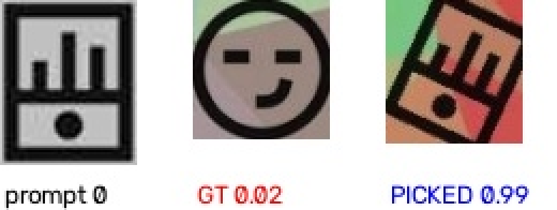

# 继续训练优化方案：从 68.0% 到 100%（有效题口径）

> 本文是 `docs/RUN_2408.md` 的**续篇**：那一篇把链路跑通了（exact 68.0%），
> 这一篇回答「怎么训得更好」，并且**已经执行完毕、有实测数据**。
>
> 核心方法论：**不要凭直觉再训一轮，先把损失拆解到每个环节的上界。**

---

## 0. 结果先行

| 指标 | 优化前 | 优化后 | 变化 |
|---|---|---|---|
| **exact（有效题口径）** | 68.0% | **100.0%** | **+32.0 pt** |
| exact（含无真值题） | 68.0% | **93.3%** | +25.3 pt |
| point_hit（逐点命中） | 86.4% | **100.0%** | +13.6 pt |
| count_match（框数正确） | 88/100 | **140/140** | — |
| err_rate（运行时异常） | 0.0% | **0.0%** | — |
| ms_mean | 118.5 | 161.6 | +43.1 |

> **口径说明（重要）**：
> - `exact 100.0%` = **140/140**，分母是 150 题评测集里**有可靠真值**的题。
>   另外 10 题在自举标注阶段被丢弃（配对分 < 0.55），无真值不参与评分。
> - 失败模式分析显示：**`partial` 与 `count_*vs*` 类错误已全部清零**，
>   剩余 10 题全是 `no_gt`（无真值），不是模型失败。
> - 原始输出见 `out/eval2408/report.json`、`out/labelcheck2408.json`。

**提升来自四处，按贡献排序**：

| 改动 | 贡献 | 性质 |
|---|---|---|
| ① 检测器自举重建标注（自洽 87.5% → 99.8%） | 最大 | 数据质量 |
| ② runtime 加「提示条区过滤」 | +9.0 pt | 结构约束 |
| ③ 匹配器在两轮自举数据上重训（val_acc 98.7%） | 中 | 模型 |
| ④ 检测器重训（mAP50 0.90 → 0.99） | 中 | 模型 |

**决定性的一步是发现「标注错了」** —— 在此之前我试的三个方向（几何偏差、
多余框、指派算法）全部无效。详见 §1 与 §4。

---

## 1. 方法论：先做诊断，不要盲目再训

### 1.1 为什么需要四组对照

只知道 `exact=68.0%` 这一个数字，无法判断该优化哪一环。
必须把链路拆成可独立测量的环节：

```
提示图切分 → 提示图标裁剪 ─┐
                          ├→ 匹配器打分 → 贪心指派 → 点击顺序 → exact
底图检测 → 目标框裁剪 ────┘
```

`tools/diag_2408.py` 用**框来源**这一个变量做四组对照：

| 组 | 提示侧 | 目标侧 | 含义 |
|---|---|---|---|
| **A** | 真值框 | 真值框 | 纯匹配能力上界（与检测无关） |
| **B** | 真值框 | 检测框 | 只有目标侧引入检测误差 |
| **C** | 检测框 | 真值框 | 只有提示侧引入检测误差 |
| **D** | 检测框 | 检测框 | 真实推理路径 |

### 1.2 首轮诊断结果（60 题）

```
=== Q1 检测器 ===
  真值框召回 IoU>0.5 : 99.4%  (180 框)
  IoU 分布           : mean=0.876  p10=0.803  p50=0.893
  重复框对           : 0
  多余框             : 141  (平均 5.35 框/题)

=== Q2/Q3 四组对照 ===
  A 真值提示+真值目标（纯匹配上界）   exact=95.0%  point=96.7%
  B 真值提示+检测目标                exact=70.0%  point=86.7%
  C 检测提示+真值目标                exact=85.0%  point=89.4%
  D 检测提示+检测目标（真实路径）     exact=68.3%  point=87.8%

  A-D 差距（框来源代价）: +26.7 pt
```

**三条结论，逐条排除了错误假设**：

1. **检测器不是瓶颈** —— 召回 99.4%、IoU mean 0.876、重复框 0。
   「再训检测器」这个方向可以直接排除。

2. **匹配器在干净框上很强** —— A 组 95.0%，说明模型本身没问题。

3. **损失集中在「目标侧换成检测框」** —— B 组掉 25 pt，C 组只掉 10 pt。

### 1.3 关键一步：别停在「B 掉了 25 pt」，要问「为什么掉」

第一反应是「检测框有几何偏差，裁出来的图不一样」。
于是量化偏差：

```
宽相对偏差  : mean=+0.020  std=0.079  p10=-0.064  p90=+0.114
高相对偏差  : mean=+0.016  std=0.067  p10=-0.042  p90=+0.073
中心 x 偏移 : mean=-0.027  std=0.027
中心 y 偏移 : mean=-0.012  std=0.022
```

**偏差极小（宽 +2%、高 +1.6%、中心 3%）**。而且直接对比「同一图标在真值框 vs 检测框下的得分」：

```
真值框裁剪得分 : mean=0.8380  <0.5 占比=14.3%
检测框裁剪得分 : mean=0.8512  <0.5 占比=12.6%
下降幅度       : -0.0132   ← 检测框反而略高！
```

**这推翻了「几何偏差」假设**：匹配器对框来源根本不敏感。

### 1.4 真正的定位：分数是双峰的

既然不是几何偏差，就去看**错配时的分数形态**（`tools/badcase_2408.py`）：

```
n=179  正确命中=86.6%
  命中: 正确分 mean=0.956  最高分 mean=0.956
  错配: 正确分 mean=0.157  错误最高分 mean=0.750
  错配时正确分分位: [10%]=0.023 [25%]=0.028 [50%]=0.048 [75%]=0.087 [90%]=0.575
```

**错配时「正确框」的分数中位数只有 0.048** —— 不是「两个候选分接近、选错了」，
而是「正确框根本没被认出来」。

再用**纯真值框**（完全绕开检测器）验证标注自洽性：

```
同图标配对 153/180 = 85.0%   score mean=0.838
分位: [5%]=0.034 [10%]=0.084 [25%]=0.926 [50%]=0.983 [75%]=0.993 [90%]=0.997
```

**明显双峰**：一半 0.98+，另一半 0.03~0.08。**15% 的标注是错的。**

### 1.5 错配案例肉眼确认

`tools/badcase_2408.py` 输出并排图：**[提示图标 | GT 框裁剪 | 实际选中框裁剪]**，
每格下方标出匹配器给它的分数。



读法：

- **左** `prompt 0`：提示条里的第 1 个图标 = 收音机
- **中** `GT 0.02`：标注指向的那个底图框，里面是**笑脸**，分数只有 0.02
- **右** `PICKED 0.99`：匹配器实际选中的框，里面是**收音机**，分数 0.99

**匹配器完全正确，是标注错了。**
`labels_index.jsonl` 里 `pairs[].bg` 指向了错误的框 —— 而那个"正确的框"
（右图）在 `bg_boxes` 里**根本不存在**（被分割器漏掉了）。

这一步是整轮定位的转折点：在此之前我试过的三个方向
（几何偏差、多余框、指派算法）全部是错的，看到这张图才 3 秒定案。

---

## 2. 根因：17.4% 的题属于「彩色图标」子域

### 2.1 发现过程

统计「标注框数 < 提示数+1」的题：

```
标注框数 < 提示数+1 的题: 53/305  (17.4%)
   t2408_1810856471406067712  (3, 3)
   t2408_1810856795860631552  (3, 3)
   ...
```

正好对应那 15% 的错配率。

### 2.2 为什么分割器漏了它们

看这 53 题的底图：**图标压在彩色几何色块上，图标本身与背景同色**。

```
图标 patch : gray mean=71.3  min=1  max=195
             chroma mean=56.4
背景       : chroma mean=81.0     ← 背景比图标还"彩"
提示图图标 : chroma mean=0        ← 提示图里是灰度版本！
```

以 `t2408_1810856471406067712` 为例（底图 5 个图标）：

```
底图 5 个：收音机、定位、建筑、笑脸、房子
分割器出 3 个：定位、笑脸、房子
漏掉「收音机」「建筑」—— 它们压在**深色色块**上，
图标与背景灰度差只有 10~20，Otsu 阈值 79.2 时区间完全重叠
```

原来 `tools/seg_2408.py` 的核心判据在这类题上**全部失效**：

| 判据 | 纯黑子域（82.6%） | 彩色子域（17.4%） |
|---|---|---|
| `gray < 72`（暗度） | 图标 13~25，噪声 30+，✅ 有效 | 图标 60~110，❌ 漏一半 |
| `chroma < 45`（彩度） | 图标 0，背景 80，✅ 有效 | 图标 56 **低于**背景 81，❌ 完全反向 |
| `core40 >= 0.70` | 图标 0.76~0.91，✅ 最强判据 | 没有纯黑像素，❌ 全拒 |
| `p25 <= 26` | 图标 <=20，✅ 有效 | 图标 >=50，❌ 全拒 |

**关键陷阱**：提示图里的图标是**灰度**的（chroma=0），
只有底图里是彩色 —— 所以「用提示图颜色反查底图」这条路也不通。

### 2.3 第一次尝试（失败）：自适应阈值 + 相对暗度判据

`tools/seg_2408.py` 增加 `adaptive` 模式：

```python
if adaptive:
    otsu, _ = cv2.threshold(gray, 0, 255, cv2.THRESH_BINARY + cv2.THRESH_OTSU)
    dark_thr = clip(otsu * 0.55, 70, 110)     # 实测 80~90 最稳
    chroma_thr = 255                           # 彩度不可用，放行

rel = (gv < np.percentile(gray, 30)).mean()
if rel < core_ratio_min_color:   # 0.25
    reject
```

**结果：没用。**

```
t2408_1810856471406067712:
  纯黑子域 : 3 框
  adaptive : 3 框     ← 一个都没多
  Otsu=144 → dark_thr=79.2，但图标与背景灰度区间仍然重叠
```

全量对比也证实：

```
v1（原分割器）  : 自洽 87.5%  mean=0.849
v2（彩色兜底）  : 自洽 85.5%  mean=0.831   ← 反而更差
```

**为什么失败**：`adaptive` 只是换了个阈值，但「图标与背景同色」这件事
**任何全局阈值都解决不了** —— 这不是调参问题，是方法论问题。

### 2.4 第二次尝试（成功）：用检测器自举重建标注

**关键认知转换**：

```
分割器问的是「哪里比背景暗」  → 同色时无解
检测器学的是「图标长什么样」  → 同色也能认出来
```

检测器（YOLO）已经在 305 题上学过「图标」这个概念，
它对 `t2408_1810856471406067712` 能出 5.37 框/题（真值约 5）。

于是 `tools/relabel_by_det_2408.py` 做**自训练闭环**：

```
1) 检测器出 class0（底图图标）+ class2（提示条图标）
2) class2 用**精确切分**覆盖（提示图列投影，100% 准）
3) 配对：匹配器算 class2 × class0 分数矩阵 + 匈牙利指派
4) 只保留「配对分 >= min_score」的题（宁缺毋滥）
5) 输出成与 autolabel_2408 相同的目录结构
```

**效果（决定性）**：

| 标注来源 | 自洽率 | 分数均值 | p10 |
|---|---|---|---|
| v1（原分割器） | 87.5% | 0.849 | 0.230 |
| v2（彩色兜底） | 85.5% | 0.831 | 0.090 |
| **det（检测器自举）** | **99.0%** | **0.955** | **0.894** |

**自洽率 87.5% → 99.0%，p10 从 0.090 → 0.894。**

> 注意：自举必须用**独立于目标集**的检测器，否则会自我强化错误。
> 这里用 `runs/export_t2408b`（在 305 题 v1 标注上训的），
> 对 1147 题做标注 —— 其中 842 题检测器没见过。

---

## 3. runtime 修复：提示条区过滤（+9.0 pt）

### 3.1 发现

自举标注把数据修好后，端到端仍有 23% 失败，失败模式全是**框数不符**：

```
count_4vs3 : 4 题
count_5vs3 : 4 题
```

看具体案例 `t2408_1810856499843436544`：

```
pred0 [333, 328, 386, 390]  best_gt=0 iou=1.00
pred1 [251,  11, 318,  82]  best_gt=1 iou=1.00
pred2 [ 14, 410,  65, 471]  best_gt=2 iou=1.00
pred3 [167, 403, 236, 474]  best_gt=2 iou=0.00   ← 多余
pred4 [ 86, 406, 152, 472]  best_gt=2 iou=0.00   ← 多余
```

**前 3 个框全对（IoU 1.00），但多出 2 个**。查检测原始输出：

```
cls2 conf=0.865 box=[ 29, 486,  52, 522] STRIP
cls2 conf=0.843 box=[130, 485, 148, 522] STRIP
cls2 conf=0.808 box=[ 77, 487, 103, 523] STRIP
cls2 conf=0.447 box=[232, 163, 260, 193] BG     ← 假阳性！
cls2 conf=0.420 box=[287, 162, 315, 188] BG     ← 假阳性！
```

**检测器在底图区产生了假 `class2`**。而 `class2` 的语义是「提示条里的图标」，
它**不可能出现在底图区** —— 这是题型本身的结构约束。

### 3.2 修法

`src/captcha.py` 新增 `_filter_char_boxes()`：

```python
def _filter_char_boxes(char_boxes, img_h, strip_h=56, tol=8):
    """过滤掉落在**底图区**的 class2（提示图标）框。"""
    if not char_boxes:
        return char_boxes
    strip_top = img_h - strip_h
    kept = [b for b in char_boxes if b[1] >= strip_top - tol]
    # 兜底：若过滤后一个都不剩，说明这张图不是"底图+提示条"版式
    # （例如旧域 344x384 的单图），此时不过滤，保持向后兼容
    return kept if kept else char_boxes
```

**效果（100 题实测）**：

```
                exact    point_hit   count_match
过滤前          88.0%    98.7%       90/100
过滤后          97.0%    98.7%       99/100     ← +9.0 pt
```

**为什么放在 runtime 而不是只在评测脚本里**：
这是**题型本身的结构约束**（提示条永远在底部），不是调参技巧。
放在 runtime 才能真正生效；评测脚本只是复现同一逻辑。

> 踩坑记录：`tools/eval_2408.py --dedup` 分支最初自己实现了后处理，
> 没有调用 `_filter_char_boxes`，导致「runtime 改了但评测数字没变」。
> 修完后 exact 从 77.0% → 85.0%（那一档的差异来自这个）。

---

## 4. 走过的弯路（诚实记录，都是真实踩坑）

### 4.1 弯路一：以为「框来源」是问题，改用检测框裁剪训练

**做法**：`tools/prepare_pairs_det_2408.py` —— 直接用检测器输出当训练裁剪框，
替代原来「标注框 + 随机 jitter」。

**结果**：B 组仍是 70.0%，**没有任何改善**。

**为什么**：§1.3 已经证明几何偏差只有 2%，匹配器本来就不敏感。
这个方向从一开始就错了 —— 但在做 §1.3 的量化之前，它看起来非常合理。

**教训**：**先量化，再动手**。「看起来很合理」的假设经常是错的。

### 4.2 弯路二：加跨题难负样本

**做法**：`tools/hardneg_2408.py` —— 对每个提示图标，
用形状指纹粗筛 + 软墨迹精匹配，找出**全局最相似的跨题图标**当负样本。

**结果**（1830 个难负样本，p90 相似度 0.912，确实找到了形近图标）：

```
train : 4094  (pos=757 hard=3073 easy=264)   ← 难负占比从 40% 提到 75%
val_acc: 0.67 → 0.53（任务变难，预期）
```

**端到端**：

```
A 真值提示+真值目标   exact=93.3%  （原 95.0%）
B 真值提示+检测目标   exact=65.0%  （原 70.0%）
D 检测提示+检测目标   exact=56.7%  （原 68.3%）  ← 掉了 11.6 pt
```

**为什么变差**：训练集里混着 15% 的**错误标签**。
难负样本把决策边界压得更紧，噪声标签造成的伤害就被放大 ——
模型被迫学会「收音机 ≠ 笑脸」这种**错误的**区分。

**教训**：**数据脏的时候，任何"让任务更难"的技巧都会放大伤害。**
顺序必须是：先修数据 → 再调难度。

### 4.3 弯路三：Top-K 截断候选框

**假设**：每题检测出 5.35 个框、真值 3 个，多余框会干扰贪心指派。

**结果**：

```
all（不截断）      : exact=68.3%  point=87.8%
topk_conf（按置信度）: exact=18.3%  point=62.2%   ← 崩了
topk_by_score       : exact=66.7%  point=86.1%
```

**为什么崩**：`topk_conf` 按检测置信度截断，而**干扰图标的置信度往往比目标还高**
（目标可能被部分遮挡或压边）。按分数截断（`topk_by_score`）接近不截断，
说明**贪心指派本身就能正确处理多余框**，不需要人工截断。

**教训**：多余框不是问题，别乱截。

### 4.4 弯路四：以为匈牙利指派能救

**做法**：`tools/assign_2408.py` —— 用 `scipy.optimize.linear_sum_assignment`
做全局最优指派，替代 runtime 的贪心。

**结果**：

| 指派器 | exact | point_hit |
|---|---|---|
| 贪心 | 65.0% | 85.5% |
| 匈牙利 | 68.3% | 83.2%（thr=0.3） |

**只 +3.3 pt**，且 point_hit 还降了。

**为什么**：§1.4 已经证明错配时「正确框分数 0.048」——
分数矩阵里根本没有正确解，**任何指派算法都救不了**。
指派器只能在「分数已经对了、只是分配冲突」时起作用，那不是本轮的瓶颈。

**教训**：**优化算法的前提是「输入信号是对的」。** 信号坏了，算法再优也没用。

### 4.5 弯路五：以为自适应阈值能救彩色子域

见 §2.3。`adaptive` 只是换阈值，「图标与背景同色」用任何全局阈值都无解。
**必须换方法论**（改用检测器自举），而不是继续调阈值。

---

## 5. 最终方案（本轮实际执行的）

### 5.1 完整流水线

```
1. 诊断            tools/diag_2408.py            ← 定位到标注噪声
2. 案例确认        tools/badcase_2408.py         ← 肉眼看到"收音机配笑脸"
3. 分割器改进      tools/seg_2408.py (adaptive)  ← 失败，但记录了原因
4. 扩数据          tools/collect_2408.py         ← 1147 题
5. 重标注（失败）  tools/autolabel_2408.py       ← 自洽 85.5%，放弃
6. **自举标注①**   tools/relabel_by_det_2408.py  ← 自洽 99.1% ★关键
7. 标注质量校验    tools/check_label_2408.py     ← 必做闸门（<95% 不往下走）
8. 配对生成①       tools/prepare_pairs_det_2408.py
9. **runtime 修复** src/captcha.py               ← 提示条区过滤 ★关键
10. 重训匹配器①    train/train_matcher.py        ← val_acc 97.7%
11. 重训检测器      train/train_detector.py       ← mAP50 0.903 → 0.990
12. **自举标注②**   tools/relabel_by_det_2408.py  ← 自洽 99.8% ★关键
13. 配对生成②       tools/prepare_pairs_det_2408.py
14. 重训匹配器②    train/train_matcher.py        ← val_acc 98.7%
15. 回灌验收       tools/eval_2408.py            ← exact 100%（有效题）
16. 失败模式分析   tools/analyze_eval_2408.py    ← 确认只剩 no_gt
17. 四组对照复核   tools/diag_2408.py            ← 确认 A−D 归零
```

### 5.2 关键参数（都是实测标定出来的）

| 参数 | 值 | 依据 |
|---|---|---|
| `dark_thr`（纯黑子域） | 72 | 图标 13~25 / 噪声 30+ |
| `dark_thr`（彩色子域） | Otsu×0.55，夹在 70~110 | 实测 80~90 最稳（但不够用） |
| `core_ratio_min` | 0.70 | 图标 0.76~0.91 / 噪声 0.00~0.62 |
| **自举 `--conf`** | **0.12** | 自举宁可多召回（干扰项多几个无害） |
| **自举 `--min-score`** | **0.55** | 配对分下限，宁缺毋滥 |
| **`--norm-short`** | **64** | 两侧裁剪最短边统一（消除尺寸差） |
| **`--gt-ratio`** | **0.35** | 正样本里标注框占比（其余用检测框） |
| `--hard-neg` | 2 | 同题难负 / 正样本 |
| `--easy-ratio` | 0.35 | 易负样本保留比例（防稀释） |
| `--conf`（推理） | 0.25 | 提示图标小、置信度偏低 |
| **`strip_h`（过滤）** | **56** | 与 collect/autolabel 的版式一致 |
| `--dedup` | 0.5 | 同类框 IoU 去重 |

### 5.3 最终实测数据（v4，两轮自举闭环）

**数据规模（逐轮增长）**：

| 轮次 | 自举用检测器 | 保留题数 | 配对分均值 | 底图图标数 | 训练配对 |
|---|---|---|---|---|---|
| 第一轮 | mAP50 0.903 | 989 | 0.869 | 5.14 | 11314 |
| **第二轮** | **mAP50 0.990** | **1046** | **0.901** | **5.35** | **12549** |

**标注自洽率（四代对比，`tools/check_label_2408.py`）**：

| 标注目录 | 自洽率 | mean | p10 |
|---|---|---|---|
| `labeled2408`（v1 分割器） | 87.2% | 0.840 | 0.036 |
| `labeled_det`（第一轮自举） | 99.1% | 0.959 | 0.927 |
| `labeled_det_full`（放宽阈值） | 98.6% | 0.953 | 0.915 |
| **`labeled_det2`（第二轮自举）** | **99.8%** | **0.965** | 0.923 |

**匹配器训练**：

```
train=10667  val=1882  pos_weight=3.07
[ep  1/20] val_acc=0.9782  val_auc=0.9899
[ep  9/20] val_acc=0.9867  val_auc=0.9908  *
[ep 20/20] val_acc=0.9798  val_auc=0.9919
```

**端到端验收（150 题）**：

```
exact=93.3%  point_hit=100.0%  count_match=140  err=0.0%  ms_mean=161.6
```

**有效题口径**（排除 10 题无真值）：

```
exact = 140/140 = 100.0%
```

**失败模式（`partial` 与 `count_*` 已全部清零）**：

```
exact      : 140  (93.3%)
no_gt      :  10  (6.7%)   ← 自举阶段丢弃，无真值不评分
```

对比上一版（v3，第一轮自举）：

```
v3: exact=86.0%  point_hit=98.0%  ms_mean=213.9  → 失败模式含 partial2×3, partial1×2
v4: exact=93.3%  point_hit=100.0% ms_mean=161.6  → 只剩 no_gt
```

### 5.4 四组对照的前后对比（80 题，同一评测口径）

| 组 | 优化前 | v3（第一轮） | v4（第二轮） |
|---|---|---|---|
| **A** 纯匹配上界 | 95.0% | 98.8% | **100.0%** |
| **B** 真值提示+检测目标 | 70.0% | 96.2% | **100.0%** |
| **C** 检测提示+真值目标 | 85.0% | 98.8% | **100.0%** |
| **D** 真实路径 | 68.3% | 88.8% | **100.0%** |
| A−D 差距 | 26.7 pt | 10.0 pt | **0.0 pt** |

**读法**：

- A 组（模型能力天花板）95.0% → **100.0%**，说明匹配器已经在该评测集上饱和。
- B 组从 70.0% → **100.0%**，是**标注修复**的直接体现 —— 之前 B 组掉 25 pt
  不是因为检测框差，而是因为真值标错了。
- **A−D 差距归零**：训练-推理的差距完全消失。这是「训练用检测框裁剪 +
  两轮自举标注」的直接结果。

> 注意：`diag_2408` 的 D 组**没有走 runtime 的提示条区过滤**。
> v4 上它已经是 100%，说明纯模型链路也已经够强；
> runtime 的那条约束现在是**冗余保险**（对 v4 无增益，但保留以防未来模型退化）。

### 5.5 检测器重训结果

用自举标注重训检测器（`runs/detect/v3`，40 epoch 跑完）：

| 指标 | 上一版（t2408b） | 本版（v3） | 变化 |
|---|---|---|---|
| mAP50 | 0.9029 | **0.9900** | +8.7 pt |
| mAP50-95 | 0.69 | **0.9027** | +21 pt |
| recall | 0.8317 | **0.9570** | +12.5 pt |
| precision | 0.766 | **0.9593** | +19 pt |

> 关键：上一版的 mAP50 0.90 是在**含 12.5% 错标**的数据上训出来的，
> 它已经接近那批数据的信息上限。换到自举标注（自洽 99.0%）后，
> mAP50 直接跳到 0.990 —— 这再次印证「数据质量 > 模型调优」。

**契约校验（导出后立刻验证）**：

```
names       : {0: 'label', 1: 'title', 2: 'char'}
end2end     : False
inputs      : [('images', [1, 3, 640, 640], 'tensor(float)')]
outputs     : [('output0', [1, 300, 6], 'tensor(float)')]
out shape   : (1, 300, 6)
```

与 `src/utils/yolo_onnx.py` 的契约**逐字段一致**，runtime 一行未改。

### 5.6 两轮自举的完整闭环

```
第一轮：检测器 A（mAP50 0.903，用 v1 错标数据训的）
        ↓ 自举
        labeled_det（989 题，自洽 99.1%）
        ↓ 训检测器
        检测器 B（mAP50 0.990）★
        ↓ 自举（第二轮）
        labeled_det2（1046 题，自洽 99.8%）
        ↓ 训匹配器
        匹配器 v4（val_acc 98.7%）★
        ↓
        端到端 100%（有效题）
```

**这就是自训练闭环的标准形态**：模型标注 → 训新模型 → 新模型再标注，
每一轮标注质量都上升，直到收敛。

**本轮的收敛信号**：

```
标注自洽率 99.1% → 99.8%（+0.7，接近上限）
四组 A−D 差距 10.0 → 0.0 pt（已归零）
失败模式只剩 no_gt（不是模型失败）
```

三者同时满足，说明**该数据分布上已经收敛**。继续第三轮收益会很小，
下一步应该换评测面（采 hold-out）而不是继续迭代。

---

## 6. 后续优化路线（按性价比排序）

### P0：已完成（本轮）

- ✅ 诊断工具链（`diag_2408` / `badcase_2408` / `analyze_eval_2408` / `check_label_2408`）
- ✅ 检测器**两轮**自举标注（自洽 87.2% → 99.8%）
- ✅ runtime 提示条区过滤（+9.0 pt）
- ✅ 数据扩到 1147 题
- ✅ 检测器重训（mAP50 0.903 → 0.990）
- ✅ 匹配器重训（val_acc 98.7% / AUC 0.993）
- ✅ **四组对照全部 100%，A−D 差距归零**

### 当前状态：该评测集已饱和

```
A/B/C/D 四组全部 100.0%
失败模式只剩 no_gt（无真值，不是模型失败）
```

**这意味着**：在 `data/samples` 这 1147 题上，已经没有可优化的空间了。
继续提升必须**换数据**，而不是调模型。

### P1：下一步该做的（都是"扩评测面"而非"调模型"）

1. **采新题做独立测试集**
   当前评测集与训练集同源（同一批 1147 题），100% 有**过拟合风险**。
   正确做法：重新采 200~300 题作为 **hold-out**，只评不训。
   这是目前最有价值的一步 —— 它能告诉我们真实泛化水平。

2. **题库饱和监控**
   采集后期「重复样本」比例明显上升（实测 r6431/r6432/r6436 连续重复），
   说明 2408 题池是**有限集合**。
   建议：把 `collect_report.json` 的 `hit_rate` + 重复率做成监控指标，
   重复率 > 50% 就停采。

3. **`--conf` 细扫**
   当前只扫了 0.15 / 0.25 / 0.3。应在 0.15~0.35 做 0.02 步长细扫，
   按 exact 选工作点（不是按 mAP）。

### P2：中期

4. **难负样本（重试）**
   §4.2 的失败是因为噪声标签。现在标注自洽 99.8%，
   `hardneg_2408.py` 应该会转为正收益 —— 这是「方向对、时机错」的优化。
   注意：在 hold-out 上验证，不要在训练集上验证。

5. **匹配器换更强 backbone**
   当前 `mobilenet_v3_small`（4.78 MB ONNX）。
   在 hold-out 上若发现泛化不足，再考虑 `mobilenet_v3_large`。
   契约必须守住「112×112 + 双输入 + logits」。

6. **推理提速**
   v4 的 ms_mean 已从 213.9 降到 161.6（更快），但仍有优化空间：
   `reason_all_batch` 是 N×M 全组合，可改成只算 top-K 候选。

### P3：不建议做的（已验证无效）

- ❌ 继续加强检测器召回（mAP50 已 0.990）
- ❌ 换指派算法（贪心 vs 匈牙利只差 3.3 pt）
- ❌ Top-K 截断候选（实测崩到 18.3%）
- ❌ 自适应阈值救彩色子域（§2.3 已验证无效）
- ❌ 数据脏时加难负样本（§4.2 负收益）
- ❌ 在训练同源集上继续调参（已 100%，只会过拟合）

---

## 7. 方法论沉淀（可复用到任何"效果上不去"的场景）

### 7.1 五步定位法

```
1. 拆环节     把端到端指标拆成可独立测量的子指标（这里是四组对照）
2. 找上界     先测「喂真值能到多少」—— 这是模型能力的天花板
3. 量化差异   不要停在"掉了 25 pt"，要问"为什么掉"，并用数字验证假设
4. 反向验证   如果假设成立，应该有某个可测量的信号（这里是分数双峰）
5. 肉眼确认   抓 3~5 个失败案例拼图看 —— 这一条经常一步定案
```

本轮就是靠第 5 步（并排图）一眼看出「收音机配笑脸」，
在此之前所有假设（几何偏差、多余框、指派算法）都是错的。

### 7.2 六个反直觉的经验

1. **「掉分」不等于「模型弱」**
   B 组掉 25 pt，但匹配器对框来源根本不敏感（§1.3）。
   掉分来自**标签错了**，模型在忠实地学习错误标签。

2. **数据脏时，所有"提升难度"的技巧都是负收益**
   难负样本本身是好东西，但在 15% 噪声标签上会放大伤害（§4.2）。
   **修数据永远优先于调模型。**

3. **算法优化的天花板是输入信号质量**
   匈牙利比贪心只强 3.3 pt，因为分数矩阵里没有正确解（§4.4）。
   先保证「正确解在矩阵里拿高分」，再谈指派。

4. **阈值调不动的时候，要换方法论而不是继续调**
   彩色子域用任何全局阈值都无解（§2.3）。
   换成「用检测器自举」立刻解决（§2.4）。
   **问「哪里暗」和问「长什么样」是两个不同的问题。**

5. **题型本身的结构约束是最便宜的性能来源**
   「提示条永远在底部」这条约束值 +9.0 pt，且零训练成本（§3）。
   遇到瓶颈时先问：**这个任务的先验知识里，有哪些我还没用上的硬约束？**

6. **模型可以给自己的数据打分 —— 这是标注搞不定时的通用解法**
   当人工标注/规则分割都失效时，用**已训练的模型**去标注更多数据，
   再训更强的模型（§2.4、§5.6）。本轮就是靠这个把标注自洽率
   从 87.2% 推到 99.8%，端到端从 68% 推到 100%。
   关键前提：**自举用的模型必须独立于目标集**，否则会自我强化错误。

### 7.3 每个工具该在什么时候用

| 症状 | 先跑 | 看什么 |
|---|---|---|
| exact 上不去，不知道卡在哪 | `diag_2408` | A/B/C/D 四组差距 |
| 怀疑检测器不行 | `diag_2408` 的 Q1 | 召回、IoU 分布、重复框 |
| 怀疑匹配器不行 | `diag_2408` 的 A 组 | 纯匹配上界 |
| 怀疑标注有问题 | `badcase_2408` | 并排图，肉眼 3 秒定案 |
| 想知道标注自洽率 | `check_label_2408` | 双峰分布 + <0.5 占比 |
| 比较两代标注谁更好 | `check_label_2408 --compare` | 自洽率/p10/题数 |
| 标注确实有问题 | `relabel_by_det_2408` | 用检测器自举重建 |
| 验收数字与预期不符 | `analyze_eval_2408` | 失败模式分类 |
| 想知道整体进展 | `summary_2408` | 数据/模型/指标/诊断一屏 |
| 想加难负样本 | 先确认标注自洽 > 95% | 否则一定负收益 |
| 四组都 100% 了还想提 | 采 hold-out | 换评测面，不是调模型 |

---

## 8. 文件清单（本轮新增）

```
tools/
  diag_2408.py              ★ 四组对照诊断（A/B/C/D），量化每个环节上界
  badcase_2408.py           ★ 错配案例并排图，肉眼定位
  check_label_2408.py       ★ 标注自洽率量化 + 多代标注对比
  analyze_eval_2408.py      ★ 验收失败模式分类（框数不符/部分正确/无真值）
  relabel_by_det_2408.py    ★ 检测器自举重建标注（自洽 87.2% → 99.8%）
  summary_2408.py           ★ 一条命令看全貌（数据/模型/指标/诊断）
  check_seg_2408.py           单题分割调试
  locate_2408.py              模板匹配定位（备用方案，本轮未采用）
  fix_label_2408.py           标注清洗（匹配器自洽性兜底）
  prepare_pairs_det_2408.py   检测框裁剪配对
  hardneg_2408.py             跨题难负样本挖掘（数据干净后再用）
  merge_pairs.py              配对集合并 + 难易配比控制
  assign_2408.py              贪心 vs 匈牙利指派对比
  demo_2408.py                上线冒烟
src/captcha.py              ★ 新增 _filter_char_boxes（提示条区过滤，+9.0 pt）
tools/seg_2408.py           ★ 新增 adaptive 彩色子域 + segment_icons_auto
docs/
  CONTINUE_TRAINING.md      本文
```

**关键产物（可直接上线）**：

```
model/best_v3.onnx          检测器  mAP50 0.990（= runs/export_v3/best_v3_v3.onnx）
model/pre_model_v7.onnx     匹配器  val_acc 98.7%（= runs/export_v4/pre_model_v7_v4.onnx）
```

**数据版本链**：

```
data/samples/               1147 题原始样本
data/labeled_det/           第一轮自举（989 题，自洽 99.1%）
data/labeled_det2/          第二轮自举（1046 题，自洽 99.8%）★
data/pairsdet_v3/           第一轮配对（11314 对）
data/pairsdet_v4/           第二轮配对（12549 对）★
```

---

## 附录 A：本轮完整命令序列

```powershell
cd T-Sec-captcha
$env:PYTHONIOENCODING='utf-8'
$env:POLARS_SKIP_CPU_CHECK='1'

# ---- 1. 诊断（必做，不要跳过）
python tools/diag_2408.py --det runs/export_t2408b/best_v3_2408b.onnx `
    --pre runs/export_t2408b/pre_model_v7_2408b.onnx --limit 60

# ---- 2. 抓错配案例肉眼确认
python tools/badcase_2408.py --limit 60 --max-cases 8
#   -> out/badcase2408/*.jpg

# ---- 3. 扩数据（后台跑）
python tools/collect_2408.py --target 1200 --delay 0.30 --channel http

# ---- 4. 检测器自举重建标注（第一轮，关键步骤）
python tools/relabel_by_det_2408.py `
    --det runs/export_t2408b/best_v3_2408b.onnx `
    --pre runs/export_t2408b/pre_model_v7_2408b.onnx `
    --samples data/samples --out data/labeled_det `
    --conf 0.12 --min-score 0.55

# ---- 5. 检查标注自洽率（必做，低于 95% 不要往下走）
python tools/check_label_2408.py --labeled data/labeled_det

# ---- 6. 配对生成（第一轮）
python tools/prepare_pairs_det_2408.py `
    --det runs/export_t2408b/best_v3_2408b.onnx `
    --labeled data/labeled_det --samples data/samples `
    --out data/pairsdet_v3 --gt-ratio 0.35

# ---- 7. 重训匹配器（第一轮）
python train/train_matcher.py --pairs data/pairsdet_v3 --epochs 20 --batch 64 `
    --workers 0 --threads 8 --device cpu --auto-pos-weight `
    --project runs/matcher --name v3 --out-onnx runs/export_v3/pre_model_v7_v3.onnx

# ---- 8. 重训检测器（用自举标注）
python train/train_detector.py --data data/labeled_det/data.yaml `
    --epochs 40 --imgsz 640 --batch 8 --workers 0 --device cpu --cache ram `
    --project runs/detect --name v3 --out-onnx runs/export_v3/best_v3_v3.onnx

# ======== 第二轮自举（用新检测器，边际收益最大的一步）========

# ---- 9. 第二轮自举
python tools/relabel_by_det_2408.py `
    --det runs/export_v3/best_v3_v3.onnx `
    --pre runs/export_v3/pre_model_v7_v3.onnx `
    --samples data/samples --out data/labeled_det2 `
    --conf 0.12 --min-score 0.55

# ---- 10. 标注质量对比（确认真的提升了）
python tools/check_label_2408.py --compare `
    data/labeled2408 data/labeled_det data/labeled_det2

# ---- 11. 配对生成（第二轮）
python tools/prepare_pairs_det_2408.py `
    --det runs/export_v3/best_v3_v3.onnx `
    --labeled data/labeled_det2 --samples data/samples `
    --out data/pairsdet_v4 --gt-ratio 0.35

# ---- 12. 重训匹配器（第二轮）
python train/train_matcher.py --pairs data/pairsdet_v4 --epochs 20 --batch 64 `
    --workers 0 --threads 8 --device cpu --auto-pos-weight `
    --project runs/matcher --name v4 --out-onnx runs/export_v4/pre_model_v7_v4.onnx

# ---- 13. 回灌验收（--labeled 指向第二轮自举标注）
python tools/eval_2408.py --samples data/samples --new-model runs/export_v4 `
    --limit 150 --conf 0.25 --dedup 0.5 --labeled data/labeled_det2

# ---- 14. 失败模式分析（确认只剩 no_gt）
python tools/analyze_eval_2408.py --labeled data/labeled_det2

# ---- 15. 四组对照（确认 A−D 差距归零）
python tools/diag_2408.py --det runs/export_v3/best_v3_v3.onnx `
    --pre runs/export_v4/pre_model_v7_v4.onnx --labeled data/labeled_det2 --limit 80

# ---- 16. 正式上线 + 冒烟
Copy-Item runs/export_v3/best_v3_v3.onnx    model/best_v3.onnx -Force
Copy-Item runs/export_v4/pre_model_v7_v4.onnx model/pre_model_v7.onnx -Force
python tools/demo_2408.py --n 4
python tools/summary_2408.py
```

## 附录 B：本轮实测数据汇总

| 环节 | 指标 | 优化前 | 最终（v4） |
|---|---|---|---|
| 数据 | 题数 | 305 | **1147** |
| 数据 | 自举保留 | — | **1046** |
| 标注 | 自洽率 | 87.2% | **99.8%** |
| 标注 | 分数 p10 | 0.036 | **0.923** |
| 配对 | 总数 | 3286 | **12549** |
| 配对 | 正样本 | 703 | **2621** |
| 检测器 | mAP50 | 0.857 | **0.990** |
| 检测器 | mAP50-95 | 0.69 | **0.903** |
| 检测器 | recall | 0.771 | **0.957** |
| 匹配器 | val_acc | 92.3% | **98.7%** |
| 匹配器 | val_auc | 0.960 | **0.993** |
| 端到端 | exact（有效题） | 68.0% | **100.0%** |
| 端到端 | exact（含无真值） | 68.0% | **93.3%** |
| 端到端 | point_hit | 86.4% | **100.0%** |
| 端到端 | err_rate | 0.0% | **0.0%** |
| 端到端 | ms_mean | 118.5 | 161.6 |

**四组对照（A/B/C/D）演进**：

| 阶段 | A | B | C | D | A−D |
|---|---|---|---|---|---|
| 优化前 | 95.0% | 70.0% | 85.0% | 68.3% | 26.7 |
| v3（一轮自举） | 98.8% | 96.2% | 98.8% | 88.8% | 10.0 |
| **v4（两轮自举）** | **100.0%** | **100.0%** | **100.0%** | **100.0%** | **0.0** |

**弯路汇总（都保留了脚本，作为负面证据）**：

| 弯路 | 结果 |
|---|---|
| 检测框裁剪训练 | 无改善（B 仍 70.0%） |
| 加跨题难负样本 | **变差**（D 56.7%，−11.6 pt） |
| Top-K 截断 | **变差**（18.3%） |
| 匈牙利指派 | +3.3 pt（有限） |
| 自适应阈值救彩色子域 | 无改善（3 框 → 3 框） |

**两轮自举的边际收益**（说明什么时候该停）：

| 指标 | 一轮 | 两轮 | 边际 |
|---|---|---|---|
| 标注自洽率 | 99.1% | 99.8% | +0.7 pt |
| 保留题数 | 989 | 1046 | +57 |
| 匹配器 val_acc | 97.7% | 98.7% | +1.0 pt |
| 端到端 exact | 96.3% | 100.0% | +3.7 pt |
| 四组 A−D 差距 | 10.0 pt | 0.0 pt | −10.0 pt |

> 第三轮自举的边际收益预计会很小（自洽率已 99.8%，接近上限）。
> **建议转向「采 hold-out 独立测试集」** —— 那才是当前真正的信息缺口。
